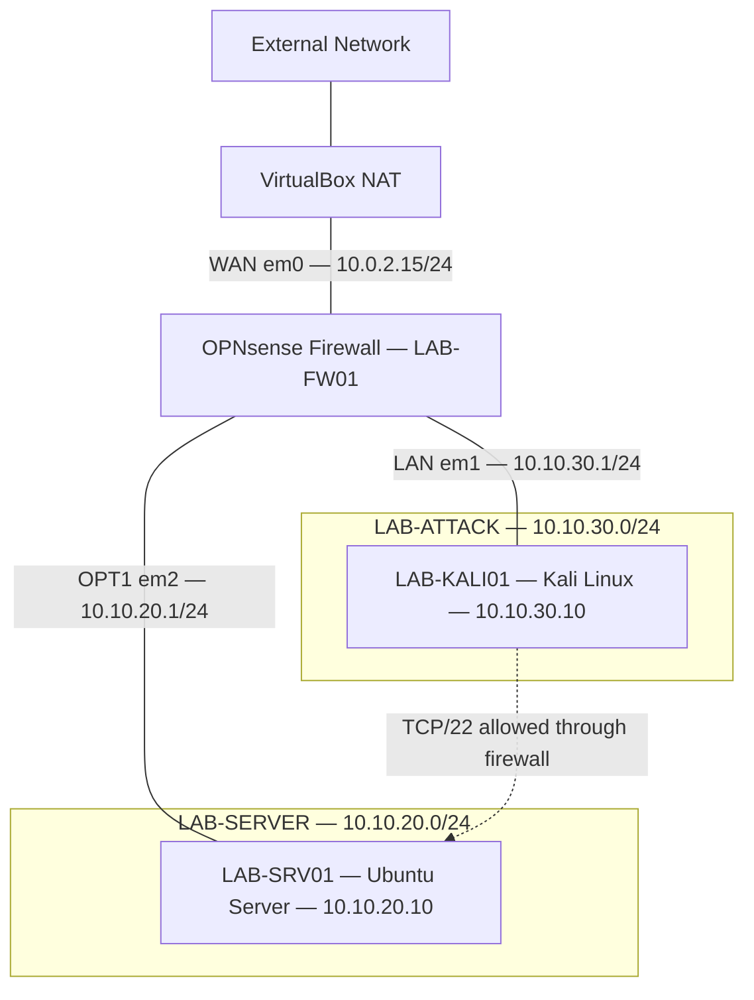

# Network Architecture

## Enterprise Network Segmentation Lab

This lab implements two isolated VirtualBox internal networks, connected through an OPNsense firewall that enforces inter-segment access controls.

## Logical Network Topology

The dotted connection represents the permitted logical SSH path through OPNsense, not a direct network connection between the virtual machines.

## Network Inventory

| System | Role | Address | Network |
|---|---|---|---|
| LAB-FW01 | OPNsense firewall WAN | 10.0.2.15/24 | VirtualBox NAT |
| LAB-FW01 | OPNsense LAN gateway | 10.10.30.1/24 | LAB-ATTACK |
| LAB-FW01 | OPNsense OPT1 gateway | 10.10.20.1/24 | LAB-SERVER |
| LAB-KALI01 | Security testing workstation | 10.10.30.10/24 | LAB-ATTACK |
| LAB-SRV01 | Protected Ubuntu Server | 10.10.20.10/24 | LAB-SERVER |

## Security Architecture

**Segmentation:** The attack and server environments use separate VirtualBox internal networks. OPNsense provides routing and stateful firewall enforcement between them.

**Authorized access:** An explicit firewall rule permits IPv4 TCP/22 from the Kali workstation to Ubuntu Server.

**Restricted access:** The tested Kali-to-Ubuntu IPv4 ICMP traffic is blocked. Other protocols and IPv6 isolation have not been comprehensively validated.

**SSH hardening:** Ubuntu uses Ed25519 public-key authentication, with password authentication and direct root SSH login disabled.

**Security monitoring:** Ubuntu's SSH journal records authentication activity, including invalid-user connection attempts.

## Scope and Limitations

- This is a virtual network simulation, not a production environment.
- The segments are VirtualBox internal networks, not physical or tagged VLANs.
- IPv6 firewall policy validation is pending.
- The status of a temporary external ICMP diagnostic rule requires confirmation.
- VirtualBox guest performance issues remain under investigation.

## Supporting Documentation

- [Engineering Lab Journal](lab-journal.md)
- [Security Validation Report](security-validation.md)
